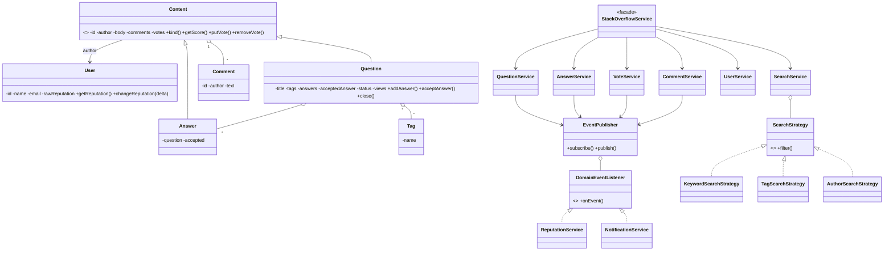

# Stack Overflow - Low Level Design (Java)

A complete, compiled and tested LLD of a Stack Overflow style Q&A platform.
Folder layout follows your repository: `demo / dto / enums / model / repository / service`.

---

## 1. Requirements

**Functional**
1. Users register (unique email) and have a reputation score.
2. Users ask questions with 1-5 tags, and answer questions..
3. Users comment on questions and answers.
4. Users upvote / downvote questions and answers (one vote per user per post, cannot vote on own post, same vote again = undo, opposite vote = switch).
5. The question author can accept exactly one answer (changing it reverses the old reputation).
6. Reputation is updated automatically from votes and acceptance.
7. Search questions by keyword, tags, author, with sorting (newest / most voted / most viewed).
8. Question author (or a user with 500+ reputation) can close a question; closed questions reject new answers.
9. Users get notifications about answers, comments, votes, acceptance and closure.

**Non-functional**
- Thread-safe (concurrent voting must never lose or double count a vote).
- Storage is abstracted behind repositories, so in-memory can be swapped for a DB.
- Easy to extend (new search filters, new reputation rules, new notification channels).

---

## 2. Core entities

| Class | Responsibility |
|---|---|
| `User` | id, name, email, reputation (floor of 1 when displayed) |
| `Content` (abstract) | author, body, comments, votes (`userId -> VoteType`), score |
| `Question extends Content` | title, tags, answers, accepted answer, status, view counter |
| `Answer extends Content` | belongs to a question, `accepted` flag |
| `Comment` | author + text, attached to a Content |
| `Tag` | unique lower-case name |
| `IdGenerator` | thread-safe ids: `Q-1`, `A-3`, `U-2` ... |

Enums: `VoteType`, `QuestionStatus`, `ContentKind`, `EventType`, `SortBy`.
DTOs: `QuestionRequest`, `AnswerRequest`, `CommentRequest`, `SearchCriteria` (builder), `DomainEvent`.

---

## 3. Class diagram



---

## 4. Design patterns used

| Pattern | Where | Why |
|---|---|---|
| **Observer** | `EventPublisher`, `DomainEventListener`, `ReputationService`, `NotificationService` | Services only publish events; reputation and notifications react. Adding badges or email later needs zero changes to existing services. |
| **Strategy** | `SearchStrategy` + 3 implementations, `SortBy` comparators | Add a new filter by adding a class and registering it. |
| **Facade** | `StackOverflowService` | One entry point for the UI / REST layer; wires everything. |
| **Repository** | `Repository<T>`, `InMemoryRepository<T>` and concrete repos | Persistence is swappable (JPA, Mongo ...). |
| **Builder** | `SearchCriteria.Builder` | Readable optional filters. |
| **Template / Inheritance** | `Content` -> `Question` / `Answer` | Votes and comments written once, reused by both. |

---

## 5. Business rules

**Voting** (`VoteService`)
- Own post -> rejected.
- No previous vote -> add. Same vote again -> remove (undo). Opposite vote -> remove old, add new.

**Reputation** (`ReputationService`)

| Event | Effect |
|---|---|
| Question upvoted | author +5 |
| Answer upvoted | author +10 |
| Any downvote received | author -2 |
| Answer downvoted | voter -1 |
| Answer accepted | answer author +15, question author +2 (nothing if self-accepted) |
| Vote removed / answer un-accepted | exact reverse |

Reputation is stored as a raw total and clamped to a minimum of 1 only when read. Clamping on every write would break reversals (a downvote on a rep-1 user followed by an undo would inflate their score; this was caught and fixed during testing).

---

## 6. Concurrency

- `ConcurrentHashMap`, `CopyOnWriteArrayList`, `AtomicInteger`/`AtomicLong` for shared collections and counters.
- `VoteService.vote` runs inside `synchronized (content)`, so check-then-update of a user's vote and the resulting events are atomic per post. Different posts do not block each other.
- `Question.addAnswer` / `acceptAnswer` / `close` are synchronized on the question, so an answer cannot sneak into a question that is being closed.
- `UserService.register` is synchronized so the unique-email check cannot race.
- `Main` includes a test where 200 users upvote the same answer at the same time and asserts the score and reputation are exact.

---

## 7. Source code

### `enums/`

#### `enums/VoteType.java`

```java
package enums;

/** Direction of a vote cast on a question or an answer. */
public enum VoteType {
    UPVOTE(1),
    DOWNVOTE(-1);

    private final int value;

    VoteType(int value) {
        this.value = value;
    }

    public int value() {
        return value;
    }
}
```

#### `enums/QuestionStatus.java`

```java
package enums;

/** Lifecycle state of a question. A CLOSED question no longer accepts new answers. */
public enum QuestionStatus {
    OPEN,
    CLOSED
}
```

#### `enums/ContentKind.java`

```java
package enums;

/** The two kinds of votable content. Reputation rules differ between them. */
public enum ContentKind {
    QUESTION,
    ANSWER
}
```

#### `enums/EventType.java`

```java
package enums;

/** Domain events published by services and consumed by observers (reputation, notifications). */
public enum EventType {
    QUESTION_POSTED,
    QUESTION_CLOSED,
    ANSWER_POSTED,
    ANSWER_ACCEPTED,
    ANSWER_ACCEPT_REVOKED,
    COMMENT_ADDED,
    VOTE_ADDED,
    VOTE_REMOVED
}
```

#### `enums/SortBy.java`

```java
package enums;

/** Sort orders supported by search. */
public enum SortBy {
    NEWEST,
    MOST_VOTED,
    MOST_VIEWED
}
```

### `model/`

#### `model/IdGenerator.java`

```java
package model;

import java.util.Map;
import java.util.concurrent.ConcurrentHashMap;
import java.util.concurrent.atomic.AtomicLong;

/** Thread-safe, prefix-based id generator: Q-1, Q-2, A-1, C-1, U-1 ... */
public final class IdGenerator {

    private static final Map<String, AtomicLong> COUNTERS = new ConcurrentHashMap<>();

    private IdGenerator() {
    }

    public static String next(String prefix) {
        return prefix + "-" + COUNTERS.computeIfAbsent(prefix, k -> new AtomicLong()).incrementAndGet();
    }
}
```

#### `model/User.java`

```java
package model;

/**
 * A registered member of the platform.
 * Displayed reputation starts at 1 and never drops below 1 (same rule as Stack Overflow).
 * Internally the raw total is NOT clamped, so reversing an event (undoing a vote, un-accepting an answer)
 * always restores exactly the previous value instead of drifting upward.
 */
public class User {

    private static final int MIN_REPUTATION = 1;

    private final String id;
    private final String name;
    private final String email;
    private int rawReputation = MIN_REPUTATION;

    public User(String name, String email) {
        this.id = IdGenerator.next("U");
        this.name = name;
        this.email = email;
    }

    public String getId() {
        return id;
    }

    public String getName() {
        return name;
    }

    public String getEmail() {
        return email;
    }

    public synchronized int getReputation() {
        return Math.max(MIN_REPUTATION, rawReputation);
    }

    public synchronized void changeReputation(int delta) {
        rawReputation += delta;
    }

    @Override
    public String toString() {
        return name + "(rep=" + getReputation() + ")";
    }
}
```

#### `model/Tag.java`

```java
package model;

import java.util.Objects;

/** A topic label attached to questions. Names are stored lower-case and are unique. */
public class Tag {

    private final String name;

    public Tag(String name) {
        this.name = name.trim().toLowerCase();
    }

    public String getName() {
        return name;
    }

    @Override
    public boolean equals(Object o) {
        return o instanceof Tag t && t.name.equals(name);
    }

    @Override
    public int hashCode() {
        return Objects.hash(name);
    }

    @Override
    public String toString() {
        return name;
    }
}
```

#### `model/Comment.java`

```java
package model;

import java.time.LocalDateTime;

/** A short remark attached to a question or an answer. Comments are not votable. */
public class Comment {

    private final String id;
    private final User author;
    private final String text;
    private final LocalDateTime createdAt = LocalDateTime.now();

    public Comment(User author, String text) {
        this.id = IdGenerator.next("C");
        this.author = author;
        this.text = text;
    }

    public String getId() {
        return id;
    }

    public User getAuthor() {
        return author;
    }

    public String getText() {
        return text;
    }

    public LocalDateTime getCreatedAt() {
        return createdAt;
    }

    @Override
    public String toString() {
        return author.getName() + ": " + text;
    }
}
```

#### `model/Content.java`

```java
package model;

import enums.ContentKind;
import enums.VoteType;

import java.time.LocalDateTime;
import java.util.ArrayList;
import java.util.Collections;
import java.util.HashMap;
import java.util.List;
import java.util.Map;
import java.util.concurrent.CopyOnWriteArrayList;

/**
 * Base class for anything that has an author, a body, comments and votes
 * (i.e. Question and Answer). Holds one vote per user: userId -> VoteType.
 * Vote methods are synchronized so the score stays consistent under concurrent voting.
 */
public abstract class Content {

    private final String id;
    private final User author;
    private final LocalDateTime createdAt = LocalDateTime.now();
    private final List<Comment> comments = new CopyOnWriteArrayList<>();
    private final Map<String, VoteType> votes = new HashMap<>();
    private volatile String body;

    protected Content(String idPrefix, User author, String body) {
        this.id = IdGenerator.next(idPrefix);
        this.author = author;
        this.body = body;
    }

    public abstract ContentKind kind();

    public String getId() {
        return id;
    }

    public User getAuthor() {
        return author;
    }

    public String getBody() {
        return body;
    }

    public void edit(String newBody) {
        this.body = newBody;
    }

    public LocalDateTime getCreatedAt() {
        return createdAt;
    }

    // ---------- comments ----------

    public void addComment(Comment comment) {
        comments.add(comment);
    }

    public List<Comment> getComments() {
        return Collections.unmodifiableList(new ArrayList<>(comments));
    }

    // ---------- votes ----------

    public synchronized VoteType getVoteBy(String userId) {
        return votes.get(userId);
    }

    public synchronized void putVote(String userId, VoteType type) {
        votes.put(userId, type);
    }

    public synchronized void removeVote(String userId) {
        votes.remove(userId);
    }

    public synchronized int getScore() {
        int score = 0;
        for (VoteType v : votes.values()) {
            score += v.value();
        }
        return score;
    }
}
```

#### `model/Answer.java`

```java
package model;

import enums.ContentKind;

/** An answer posted against a question. At most one answer per question can be accepted. */
public class Answer extends Content {

    private final Question question;
    private volatile boolean accepted;

    public Answer(User author, Question question, String body) {
        super("A", author, body);
        this.question = question;
    }

    @Override
    public ContentKind kind() {
        return ContentKind.ANSWER;
    }

    public Question getQuestion() {
        return question;
    }

    public boolean isAccepted() {
        return accepted;
    }

    void setAccepted(boolean accepted) {
        this.accepted = accepted;
    }

    @Override
    public String toString() {
        return getId() + " by " + getAuthor().getName() + " [score=" + getScore()
                + (accepted ? ", ACCEPTED" : "") + "]";
    }
}
```

#### `model/Question.java`

```java
package model;

import enums.ContentKind;
import enums.QuestionStatus;

import java.util.ArrayList;
import java.util.Collections;
import java.util.Comparator;
import java.util.List;
import java.util.Set;
import java.util.concurrent.CopyOnWriteArrayList;
import java.util.concurrent.atomic.AtomicInteger;

/** A question asked by a user, with tags, answers, an optional accepted answer and a view counter. */
public class Question extends Content {

    private final String title;
    private final Set<Tag> tags;
    private final List<Answer> answers = new CopyOnWriteArrayList<>();
    private final AtomicInteger views = new AtomicInteger();
    private Answer acceptedAnswer;
    private QuestionStatus status = QuestionStatus.OPEN;

    public Question(User author, String title, String body, Set<Tag> tags) {
        super("Q", author, body);
        this.title = title;
        this.tags = Collections.unmodifiableSet(tags);
    }

    @Override
    public ContentKind kind() {
        return ContentKind.QUESTION;
    }

    public String getTitle() {
        return title;
    }

    public Set<Tag> getTags() {
        return tags;
    }

    public int getViews() {
        return views.get();
    }

    public void incrementViews() {
        views.incrementAndGet();
    }

    public synchronized QuestionStatus getStatus() {
        return status;
    }

    public synchronized void close() {
        status = QuestionStatus.CLOSED;
    }

    public synchronized void addAnswer(Answer answer) {
        if (status != QuestionStatus.OPEN) {
            throw new IllegalStateException("Question " + getId() + " is closed and cannot take new answers");
        }
        answers.add(answer);
    }

    /** Accepted answer first, then by score (highest first), then oldest first. */
    public List<Answer> getAnswers() {
        List<Answer> copy = new ArrayList<>(answers);
        copy.sort(Comparator.comparing(Answer::isAccepted).reversed()
                .thenComparing(Comparator.comparingInt(Answer::getScore).reversed())
                .thenComparing(Answer::getCreatedAt));
        return copy;
    }

    public synchronized Answer getAcceptedAnswer() {
        return acceptedAnswer;
    }

    /**
     * Marks the given answer as the accepted one.
     * @return the previously accepted answer, or null if there was none
     */
    public synchronized Answer acceptAnswer(Answer answer) {
        Answer previous = acceptedAnswer;
        if (previous != null) {
            previous.setAccepted(false);
        }
        answer.setAccepted(true);
        acceptedAnswer = answer;
        return previous;
    }

    @Override
    public String toString() {
        return getId() + " \"" + title + "\" by " + getAuthor().getName()
                + " [score=" + getScore() + ", answers=" + answers.size()
                + ", views=" + views.get() + ", " + getStatus() + "]";
    }
}
```

### `dto/`

#### `dto/QuestionRequest.java`

```java
package dto;

import java.util.List;

/** Input for asking a question. */
public record QuestionRequest(String title, String body, List<String> tags) {
}
```

#### `dto/AnswerRequest.java`

```java
package dto;

/** Input for answering a question. */
public record AnswerRequest(String questionId, String body) {
}
```

#### `dto/CommentRequest.java`

```java
package dto;

/** Input for commenting. contentId is a question id (Q-..) or an answer id (A-..). */
public record CommentRequest(String contentId, String text) {
}
```

#### `dto/DomainEvent.java`

```java
package dto;

import enums.ContentKind;
import enums.EventType;
import enums.VoteType;
import model.User;

/**
 * Immutable event published by services.
 *
 * @param type     what happened
 * @param actor    user who performed the action
 * @param owner    user affected by / interested in the action (e.g. the author of the voted answer)
 * @param refId    id of the question / answer / comment the event is about
 * @param kind     QUESTION or ANSWER when relevant, otherwise null
 * @param voteType UPVOTE / DOWNVOTE for vote events, otherwise null
 * @param message  human readable text, used by notifications
 */
public record DomainEvent(EventType type, User actor, User owner, String refId,
                          ContentKind kind, VoteType voteType, String message) {

    public static DomainEvent of(EventType type, User actor, User owner, String refId, String message) {
        return new DomainEvent(type, actor, owner, refId, null, null, message);
    }

    public static DomainEvent vote(EventType type, User actor, User owner, String refId,
                                   ContentKind kind, VoteType voteType) {
        return new DomainEvent(type, actor, owner, refId, kind, voteType,
                actor.getName() + " " + (type == EventType.VOTE_ADDED ? "gave a " : "removed a ")
                        + voteType + " on your " + kind.name().toLowerCase() + " " + refId);
    }
}
```

#### `dto/SearchCriteria.java`

```java
package dto;

import enums.SortBy;

import java.util.HashSet;
import java.util.Set;

/** Optional filters + sort order for searching questions. Build with {@link Builder}. */
public class SearchCriteria {

    private final String keyword;
    private final Set<String> tags;
    private final String authorId;
    private final SortBy sortBy;

    private SearchCriteria(Builder b) {
        this.keyword = b.keyword;
        this.tags = b.tags;
        this.authorId = b.authorId;
        this.sortBy = b.sortBy;
    }

    public String getKeyword() {
        return keyword;
    }

    public Set<String> getTags() {
        return tags;
    }

    public String getAuthorId() {
        return authorId;
    }

    public SortBy getSortBy() {
        return sortBy;
    }

    public static Builder builder() {
        return new Builder();
    }

    public static class Builder {
        private String keyword;
        private final Set<String> tags = new HashSet<>();
        private String authorId;
        private SortBy sortBy = SortBy.NEWEST;

        public Builder keyword(String keyword) {
            this.keyword = keyword;
            return this;
        }

        public Builder tag(String tag) {
            this.tags.add(tag.trim().toLowerCase());
            return this;
        }

        public Builder authorId(String authorId) {
            this.authorId = authorId;
            return this;
        }

        public Builder sortBy(SortBy sortBy) {
            this.sortBy = sortBy;
            return this;
        }

        public SearchCriteria build() {
            return new SearchCriteria(this);
        }
    }
}
```

### `repository/`

#### `repository/Repository.java`

```java
package repository;

import java.util.List;
import java.util.Optional;

/** Minimal persistence contract. Swap the in-memory implementation for JPA/JDBC without touching services. */
public interface Repository<T> {

    T save(T entity);

    Optional<T> findById(String id);

    List<T> findAll();

    void deleteById(String id);
}
```

#### `repository/InMemoryRepository.java`

```java
package repository;

import java.util.ArrayList;
import java.util.List;
import java.util.Map;
import java.util.Optional;
import java.util.concurrent.ConcurrentHashMap;
import java.util.function.Function;

/** Thread-safe map-backed repository reused by all concrete repositories. */
public class InMemoryRepository<T> implements Repository<T> {

    private final Map<String, T> store = new ConcurrentHashMap<>();
    private final Function<T, String> idExtractor;

    public InMemoryRepository(Function<T, String> idExtractor) {
        this.idExtractor = idExtractor;
    }

    @Override
    public T save(T entity) {
        store.put(idExtractor.apply(entity), entity);
        return entity;
    }

    @Override
    public Optional<T> findById(String id) {
        return Optional.ofNullable(store.get(id));
    }

    @Override
    public List<T> findAll() {
        return new ArrayList<>(store.values());
    }

    @Override
    public void deleteById(String id) {
        store.remove(id);
    }
}
```

#### `repository/UserRepository.java`

```java
package repository;

import model.User;

import java.util.Optional;

public class UserRepository extends InMemoryRepository<User> {

    public UserRepository() {
        super(User::getId);
    }

    public Optional<User> findByEmail(String email) {
        return findAll().stream()
                .filter(u -> u.getEmail().equalsIgnoreCase(email))
                .findFirst();
    }
}
```

#### `repository/QuestionRepository.java`

```java
package repository;

import model.Question;

import java.util.List;
import java.util.stream.Collectors;

public class QuestionRepository extends InMemoryRepository<Question> {

    public QuestionRepository() {
        super(Question::getId);
    }

    public List<Question> findByTag(String tagName) {
        String t = tagName.trim().toLowerCase();
        return findAll().stream()
                .filter(q -> q.getTags().stream().anyMatch(tag -> tag.getName().equals(t)))
                .collect(Collectors.toList());
    }

    public List<Question> findByAuthor(String authorId) {
        return findAll().stream()
                .filter(q -> q.getAuthor().getId().equals(authorId))
                .collect(Collectors.toList());
    }
}
```

#### `repository/AnswerRepository.java`

```java
package repository;

import model.Answer;

import java.util.List;
import java.util.stream.Collectors;

public class AnswerRepository extends InMemoryRepository<Answer> {

    public AnswerRepository() {
        super(Answer::getId);
    }

    public List<Answer> findByQuestionId(String questionId) {
        return findAll().stream()
                .filter(a -> a.getQuestion().getId().equals(questionId))
                .collect(Collectors.toList());
    }
}
```

#### `repository/TagRepository.java`

```java
package repository;

import model.Tag;

import java.util.Map;
import java.util.concurrent.ConcurrentHashMap;

/** Tags are unique by (lower-cased) name, so the name is the id. */
public class TagRepository extends InMemoryRepository<Tag> {

    private final Map<String, Tag> byName = new ConcurrentHashMap<>();

    public TagRepository() {
        super(Tag::getName);
    }

    /** Returns the existing tag or atomically creates and stores a new one. */
    public Tag getOrCreate(String name) {
        String key = name.trim().toLowerCase();
        return byName.computeIfAbsent(key, k -> save(new Tag(k)));
    }
}
```

### `service/`

#### `service/DomainEventListener.java`

```java
package service;

import dto.DomainEvent;

/** Observer contract: anything interested in domain events implements this. */
public interface DomainEventListener {

    void onEvent(DomainEvent event);
}
```

#### `service/EventPublisher.java`

```java
package service;

import dto.DomainEvent;
import enums.EventType;

import java.util.List;
import java.util.Map;
import java.util.concurrent.ConcurrentHashMap;
import java.util.concurrent.CopyOnWriteArrayList;

/** Observer pattern subject: services publish events here; listeners subscribe per event type. */
public class EventPublisher {

    private final Map<EventType, List<DomainEventListener>> listeners = new ConcurrentHashMap<>();

    public void subscribe(EventType type, DomainEventListener listener) {
        listeners.computeIfAbsent(type, k -> new CopyOnWriteArrayList<>()).add(listener);
    }

    public void publish(DomainEvent event) {
        for (DomainEventListener l : listeners.getOrDefault(event.type(), List.of())) {
            l.onEvent(event);
        }
    }
}
```

#### `service/ReputationService.java`

```java
package service;

import dto.DomainEvent;
import enums.ContentKind;
import enums.EventType;
import enums.VoteType;

/**
 * Observer that turns domain events into reputation changes.
 *
 * Rules (modelled on Stack Overflow):
 *   question upvote   : author +5
 *   answer upvote     : author +10
 *   any downvote      : author -2
 *   answer downvote   : voter  -1
 *   answer accepted   : answer author +15, question author (accepter) +2
 * Removing a vote / un-accepting applies the exact reverse.
 */
public class ReputationService implements DomainEventListener {

    static final int QUESTION_UPVOTE = 5;
    static final int ANSWER_UPVOTE = 10;
    static final int DOWNVOTE_PENALTY = -2;
    static final int ANSWER_DOWNVOTE_VOTER_COST = -1;
    static final int ANSWER_ACCEPTED = 15;
    static final int ACCEPTER_BONUS = 2;

    public void register(EventPublisher publisher) {
        publisher.subscribe(EventType.VOTE_ADDED, this);
        publisher.subscribe(EventType.VOTE_REMOVED, this);
        publisher.subscribe(EventType.ANSWER_ACCEPTED, this);
        publisher.subscribe(EventType.ANSWER_ACCEPT_REVOKED, this);
    }

    @Override
    public void onEvent(DomainEvent e) {
        switch (e.type()) {
            case VOTE_ADDED -> applyVote(e, 1);
            case VOTE_REMOVED -> applyVote(e, -1);
            case ANSWER_ACCEPTED -> applyAccept(e, 1);
            case ANSWER_ACCEPT_REVOKED -> applyAccept(e, -1);
            default -> {
            }
        }
    }

    private void applyVote(DomainEvent e, int direction) {
        int ownerPoints;
        if (e.voteType() == VoteType.DOWNVOTE) {
            ownerPoints = DOWNVOTE_PENALTY;
        } else {
            ownerPoints = e.kind() == ContentKind.QUESTION ? QUESTION_UPVOTE : ANSWER_UPVOTE;
        }
        e.owner().changeReputation(direction * ownerPoints);

        if (e.kind() == ContentKind.ANSWER && e.voteType() == VoteType.DOWNVOTE) {
            e.actor().changeReputation(direction * ANSWER_DOWNVOTE_VOTER_COST);
        }
    }

    private void applyAccept(DomainEvent e, int direction) {
        // Accepting your own answer earns nothing.
        if (e.owner().getId().equals(e.actor().getId())) {
            return;
        }
        e.owner().changeReputation(direction * ANSWER_ACCEPTED);
        e.actor().changeReputation(direction * ACCEPTER_BONUS);
    }
}
```

#### `service/NotificationService.java`

```java
package service;

import dto.DomainEvent;
import enums.EventType;

import java.util.ArrayList;
import java.util.List;
import java.util.Map;
import java.util.concurrent.ConcurrentHashMap;
import java.util.concurrent.CopyOnWriteArrayList;

/**
 * Observer that keeps a per-user inbox. Users are never notified about their own actions.
 * In production this would hand off to email / push / WebSocket.
 */
public class NotificationService implements DomainEventListener {

    private final Map<String, List<String>> inbox = new ConcurrentHashMap<>();

    public void register(EventPublisher publisher) {
        publisher.subscribe(EventType.ANSWER_POSTED, this);
        publisher.subscribe(EventType.COMMENT_ADDED, this);
        publisher.subscribe(EventType.ANSWER_ACCEPTED, this);
        publisher.subscribe(EventType.ANSWER_ACCEPT_REVOKED, this);
        publisher.subscribe(EventType.QUESTION_CLOSED, this);
        publisher.subscribe(EventType.VOTE_ADDED, this);
    }

    @Override
    public void onEvent(DomainEvent e) {
        if (e.owner() == null || e.owner().getId().equals(e.actor().getId())) {
            return;
        }
        inbox.computeIfAbsent(e.owner().getId(), k -> new CopyOnWriteArrayList<>()).add(e.message());
    }

    public List<String> getNotifications(String userId) {
        return new ArrayList<>(inbox.getOrDefault(userId, List.of()));
    }
}
```

#### `service/UserService.java`

```java
package service;

import model.User;
import repository.UserRepository;

import java.util.List;

public class UserService {

    private final UserRepository userRepository;

    public UserService(UserRepository userRepository) {
        this.userRepository = userRepository;
    }

    /** Email must be unique; check-and-save is atomic. */
    public synchronized User register(String name, String email) {
        if (name == null || name.isBlank()) {
            throw new IllegalArgumentException("Name is required");
        }
        if (email == null || !email.contains("@")) {
            throw new IllegalArgumentException("A valid email is required");
        }
        if (userRepository.findByEmail(email).isPresent()) {
            throw new IllegalStateException("Email already registered: " + email);
        }
        return userRepository.save(new User(name.trim(), email.trim()));
    }

    public User getUser(String userId) {
        return userRepository.findById(userId)
                .orElseThrow(() -> new IllegalArgumentException("User not found: " + userId));
    }

    public List<User> getAllUsers() {
        return userRepository.findAll();
    }
}
```

#### `service/QuestionService.java`

```java
package service;

import dto.DomainEvent;
import dto.QuestionRequest;
import enums.EventType;
import model.Question;
import model.Tag;
import model.User;
import repository.QuestionRepository;
import repository.TagRepository;

import java.util.LinkedHashSet;
import java.util.Set;

public class QuestionService {

    private static final int MAX_TAGS = 5;
    private static final int CLOSE_MIN_REPUTATION = 500;

    private final QuestionRepository questionRepository;
    private final TagRepository tagRepository;
    private final EventPublisher publisher;

    public QuestionService(QuestionRepository questionRepository, TagRepository tagRepository,
                           EventPublisher publisher) {
        this.questionRepository = questionRepository;
        this.tagRepository = tagRepository;
        this.publisher = publisher;
    }

    public Question askQuestion(User author, QuestionRequest request) {
        if (request.title() == null || request.title().isBlank()) {
            throw new IllegalArgumentException("Title is required");
        }
        if (request.body() == null || request.body().isBlank()) {
            throw new IllegalArgumentException("Body is required");
        }
        if (request.tags() == null || request.tags().isEmpty() || request.tags().size() > MAX_TAGS) {
            throw new IllegalArgumentException("A question needs 1 to " + MAX_TAGS + " tags");
        }

        Set<Tag> tags = new LinkedHashSet<>();
        for (String name : request.tags()) {
            tags.add(tagRepository.getOrCreate(name));
        }

        Question question = questionRepository.save(
                new Question(author, request.title().trim(), request.body(), tags));
        publisher.publish(DomainEvent.of(EventType.QUESTION_POSTED, author, null, question.getId(),
                author.getName() + " asked " + question.getId()));
        return question;
    }

    public Question getQuestion(String questionId) {
        return questionRepository.findById(questionId)
                .orElseThrow(() -> new IllegalArgumentException("Question not found: " + questionId));
    }

    /** Opening a question page: returns it and bumps the view counter. */
    public Question viewQuestion(String questionId) {
        Question q = getQuestion(questionId);
        q.incrementViews();
        return q;
    }

    /** The author, or any user with enough reputation (moderator-like), can close a question. */
    public void closeQuestion(User requester, String questionId) {
        Question q = getQuestion(questionId);
        boolean isAuthor = q.getAuthor().getId().equals(requester.getId());
        if (!isAuthor && requester.getReputation() < CLOSE_MIN_REPUTATION) {
            throw new SecurityException(requester.getName() + " is not allowed to close " + questionId);
        }
        q.close();
        publisher.publish(DomainEvent.of(EventType.QUESTION_CLOSED, requester, q.getAuthor(), q.getId(),
                "Your question " + q.getId() + " was closed by " + requester.getName()));
    }
}
```

#### `service/AnswerService.java`

```java
package service;

import dto.AnswerRequest;
import dto.DomainEvent;
import enums.EventType;
import model.Answer;
import model.Question;
import model.User;
import repository.AnswerRepository;

public class AnswerService {

    private final AnswerRepository answerRepository;
    private final QuestionService questionService;
    private final EventPublisher publisher;

    public AnswerService(AnswerRepository answerRepository, QuestionService questionService,
                         EventPublisher publisher) {
        this.answerRepository = answerRepository;
        this.questionService = questionService;
        this.publisher = publisher;
    }

    public Answer postAnswer(User author, AnswerRequest request) {
        if (request.body() == null || request.body().isBlank()) {
            throw new IllegalArgumentException("Answer body is required");
        }
        Question question = questionService.getQuestion(request.questionId());
        Answer answer = new Answer(author, question, request.body());

        question.addAnswer(answer); // throws if the question is closed
        answerRepository.save(answer);

        publisher.publish(DomainEvent.of(EventType.ANSWER_POSTED, author, question.getAuthor(), answer.getId(),
                author.getName() + " answered your question " + question.getId()));
        return answer;
    }

    public Answer getAnswer(String answerId) {
        return answerRepository.findById(answerId)
                .orElseThrow(() -> new IllegalArgumentException("Answer not found: " + answerId));
    }

    /**
     * Only the question author can accept. Accepting a different answer silently un-accepts the previous one
     * (and reverses its reputation).
     */
    public void acceptAnswer(User requester, String answerId) {
        Answer answer = getAnswer(answerId);
        Question question = answer.getQuestion();

        if (!question.getAuthor().getId().equals(requester.getId())) {
            throw new SecurityException("Only the question author can accept an answer");
        }

        synchronized (question) {
            if (question.getAcceptedAnswer() == answer) {
                return; // already accepted - idempotent
            }
            Answer previous = question.acceptAnswer(answer);
            if (previous != null) {
                publisher.publish(DomainEvent.of(EventType.ANSWER_ACCEPT_REVOKED, requester, previous.getAuthor(),
                        previous.getId(), "Your answer " + previous.getId() + " is no longer accepted"));
            }
            publisher.publish(DomainEvent.of(EventType.ANSWER_ACCEPTED, requester, answer.getAuthor(), answer.getId(),
                    requester.getName() + " accepted your answer " + answer.getId()));
        }
    }
}
```

#### `service/CommentService.java`

```java
package service;

import dto.DomainEvent;
import enums.EventType;
import model.Comment;
import model.Content;
import model.User;

public class CommentService {

    private static final int MAX_LENGTH = 600;

    private final EventPublisher publisher;

    public CommentService(EventPublisher publisher) {
        this.publisher = publisher;
    }

    public Comment addComment(User author, Content target, String text) {
        if (text == null || text.isBlank()) {
            throw new IllegalArgumentException("Comment text is required");
        }
        if (text.length() > MAX_LENGTH) {
            throw new IllegalArgumentException("Comment is limited to " + MAX_LENGTH + " characters");
        }
        Comment comment = new Comment(author, text.trim());
        target.addComment(comment);

        publisher.publish(DomainEvent.of(EventType.COMMENT_ADDED, author, target.getAuthor(), target.getId(),
                author.getName() + " commented on your " + target.kind().name().toLowerCase()
                        + " " + target.getId()));
        return comment;
    }
}
```

#### `service/VoteService.java`

```java
package service;

import dto.DomainEvent;
import enums.EventType;
import enums.VoteType;
import model.Content;
import model.User;

/**
 * Handles voting on questions and answers.
 *
 * Rules:
 *  - you cannot vote on your own post
 *  - one vote per user per post
 *  - voting the same way again undoes the vote
 *  - voting the opposite way switches the vote (old vote is removed, new one added)
 *
 * The whole read-modify-write runs under the content's monitor, so concurrent voters can never
 * double count and reputation events are always published in a consistent order.
 */
public class VoteService {

    private final EventPublisher publisher;

    public VoteService(EventPublisher publisher) {
        this.publisher = publisher;
    }

    /** @return the new score of the content after the vote */
    public int vote(User voter, Content content, VoteType type) {
        if (content.getAuthor().getId().equals(voter.getId())) {
            throw new IllegalArgumentException("You cannot vote on your own " + content.kind().name().toLowerCase());
        }

        synchronized (content) {
            VoteType previous = content.getVoteBy(voter.getId());

            if (previous == type) {
                content.removeVote(voter.getId());
                publish(EventType.VOTE_REMOVED, voter, content, type);
            } else {
                if (previous != null) {
                    content.removeVote(voter.getId());
                    publish(EventType.VOTE_REMOVED, voter, content, previous);
                }
                content.putVote(voter.getId(), type);
                publish(EventType.VOTE_ADDED, voter, content, type);
            }
            return content.getScore();
        }
    }

    private void publish(EventType eventType, User voter, Content content, VoteType type) {
        publisher.publish(DomainEvent.vote(eventType, voter, content.getAuthor(),
                content.getId(), content.kind(), type));
    }
}
```

#### `service/SearchStrategy.java`

```java
package service;

import dto.SearchCriteria;
import model.Question;

import java.util.List;

/** Strategy pattern: each implementation narrows the result list by one criterion (or does nothing if absent). */
public interface SearchStrategy {

    List<Question> filter(List<Question> questions, SearchCriteria criteria);
}
```

#### `service/KeywordSearchStrategy.java`

```java
package service;

import dto.SearchCriteria;
import model.Question;

import java.util.List;
import java.util.stream.Collectors;

/** Case-insensitive match against question title and body. */
public class KeywordSearchStrategy implements SearchStrategy {

    @Override
    public List<Question> filter(List<Question> questions, SearchCriteria criteria) {
        String keyword = criteria.getKeyword();
        if (keyword == null || keyword.isBlank()) {
            return questions;
        }
        String k = keyword.trim().toLowerCase();
        return questions.stream()
                .filter(q -> q.getTitle().toLowerCase().contains(k) || q.getBody().toLowerCase().contains(k))
                .collect(Collectors.toList());
    }
}
```

#### `service/TagSearchStrategy.java`

```java
package service;

import dto.SearchCriteria;
import model.Question;

import java.util.List;
import java.util.stream.Collectors;

/** Keeps questions that carry ALL the requested tags. */
public class TagSearchStrategy implements SearchStrategy {

    @Override
    public List<Question> filter(List<Question> questions, SearchCriteria criteria) {
        if (criteria.getTags().isEmpty()) {
            return questions;
        }
        return questions.stream()
                .filter(q -> q.getTags().stream().map(t -> t.getName()).collect(Collectors.toSet())
                        .containsAll(criteria.getTags()))
                .collect(Collectors.toList());
    }
}
```

#### `service/AuthorSearchStrategy.java`

```java
package service;

import dto.SearchCriteria;
import model.Question;

import java.util.List;
import java.util.stream.Collectors;

public class AuthorSearchStrategy implements SearchStrategy {

    @Override
    public List<Question> filter(List<Question> questions, SearchCriteria criteria) {
        if (criteria.getAuthorId() == null) {
            return questions;
        }
        return questions.stream()
                .filter(q -> q.getAuthor().getId().equals(criteria.getAuthorId()))
                .collect(Collectors.toList());
    }
}
```

#### `service/SearchService.java`

```java
package service;

import dto.SearchCriteria;
import enums.SortBy;
import model.Question;
import repository.QuestionRepository;

import java.util.ArrayList;
import java.util.Comparator;
import java.util.List;

/** Applies every registered SearchStrategy in sequence (AND semantics), then sorts. */
public class SearchService {

    private final QuestionRepository questionRepository;
    private final List<SearchStrategy> strategies;

    public SearchService(QuestionRepository questionRepository) {
        this.questionRepository = questionRepository;
        this.strategies = List.of(
                new KeywordSearchStrategy(),
                new TagSearchStrategy(),
                new AuthorSearchStrategy());
    }

    public List<Question> search(SearchCriteria criteria) {
        List<Question> result = new ArrayList<>(questionRepository.findAll());
        for (SearchStrategy strategy : strategies) {
            result = new ArrayList<>(strategy.filter(result, criteria));
        }
        result.sort(comparatorFor(criteria.getSortBy()));
        return result;
    }

    private Comparator<Question> comparatorFor(SortBy sortBy) {
        return switch (sortBy) {
            case NEWEST -> Comparator.comparing(Question::getCreatedAt).reversed();
            case MOST_VOTED -> Comparator.comparingInt(Question::getScore).reversed();
            case MOST_VIEWED -> Comparator.comparingInt(Question::getViews).reversed();
        };
    }
}
```

#### `service/StackOverflowService.java`

```java
package service;

import dto.AnswerRequest;
import dto.CommentRequest;
import dto.QuestionRequest;
import dto.SearchCriteria;
import enums.VoteType;
import model.Answer;
import model.Comment;
import model.Content;
import model.Question;
import model.User;
import repository.AnswerRepository;
import repository.QuestionRepository;
import repository.TagRepository;
import repository.UserRepository;

import java.util.List;

/**
 * Facade: the single entry point clients (UI / REST controllers / demo) talk to.
 * It wires all repositories, services and observers together and resolves ids to entities.
 */
public class StackOverflowService {

    private final UserService userService;
    private final QuestionService questionService;
    private final AnswerService answerService;
    private final CommentService commentService;
    private final VoteService voteService;
    private final SearchService searchService;
    private final NotificationService notificationService;

    public StackOverflowService() {
        UserRepository userRepository = new UserRepository();
        QuestionRepository questionRepository = new QuestionRepository();
        AnswerRepository answerRepository = new AnswerRepository();
        TagRepository tagRepository = new TagRepository();

        EventPublisher publisher = new EventPublisher();
        new ReputationService().register(publisher);
        this.notificationService = new NotificationService();
        this.notificationService.register(publisher);

        this.userService = new UserService(userRepository);
        this.questionService = new QuestionService(questionRepository, tagRepository, publisher);
        this.answerService = new AnswerService(answerRepository, questionService, publisher);
        this.commentService = new CommentService(publisher);
        this.voteService = new VoteService(publisher);
        this.searchService = new SearchService(questionRepository);
    }

    // ---------- users ----------

    public User registerUser(String name, String email) {
        return userService.register(name, email);
    }

    public User getUser(String userId) {
        return userService.getUser(userId);
    }

    // ---------- questions ----------

    public Question askQuestion(String userId, QuestionRequest request) {
        return questionService.askQuestion(userService.getUser(userId), request);
    }

    public Question viewQuestion(String questionId) {
        return questionService.viewQuestion(questionId);
    }

    public void closeQuestion(String userId, String questionId) {
        questionService.closeQuestion(userService.getUser(userId), questionId);
    }

    // ---------- answers ----------

    public Answer answerQuestion(String userId, AnswerRequest request) {
        return answerService.postAnswer(userService.getUser(userId), request);
    }

    public void acceptAnswer(String userId, String answerId) {
        answerService.acceptAnswer(userService.getUser(userId), answerId);
    }

    // ---------- comments ----------

    public Comment comment(String userId, CommentRequest request) {
        return commentService.addComment(userService.getUser(userId), findContent(request.contentId()),
                request.text());
    }

    // ---------- votes ----------

    public int vote(String userId, String contentId, VoteType type) {
        return voteService.vote(userService.getUser(userId), findContent(contentId), type);
    }

    // ---------- search / notifications ----------

    public List<Question> search(SearchCriteria criteria) {
        return searchService.search(criteria);
    }

    public List<String> getNotifications(String userId) {
        return notificationService.getNotifications(userId);
    }

    // ---------- helpers ----------

    /** Ids are prefixed: Q-n for questions, A-n for answers. */
    private Content findContent(String contentId) {
        if (contentId.startsWith("Q-")) {
            return questionService.getQuestion(contentId);
        }
        if (contentId.startsWith("A-")) {
            return answerService.getAnswer(contentId);
        }
        throw new IllegalArgumentException("Unknown content id: " + contentId);
    }
}
```

### `demo/`

#### `demo/Main.java`

```java
package demo;

import dto.AnswerRequest;
import dto.CommentRequest;
import dto.QuestionRequest;
import dto.SearchCriteria;
import enums.SortBy;
import enums.VoteType;
import model.Answer;
import model.Question;
import model.User;
import service.StackOverflowService;

import java.util.ArrayList;
import java.util.List;
import java.util.concurrent.CountDownLatch;
import java.util.concurrent.ExecutorService;
import java.util.concurrent.Executors;

public class Main {

    public static void main(String[] args) throws Exception {
        StackOverflowService app = new StackOverflowService();

        section("1. Register users");
        User alice = app.registerUser("Alice", "alice@example.com");
        User bob = app.registerUser("Bob", "bob@example.com");
        User carol = app.registerUser("Carol", "carol@example.com");
        User dave = app.registerUser("Dave", "dave@example.com");
        System.out.println(alice + ", " + bob + ", " + carol + ", " + dave);
        expectFailure("duplicate email", () -> app.registerUser("Alice2", "alice@example.com"));

        section("2. Ask questions");
        Question q1 = app.askQuestion(alice.getId(), new QuestionRequest(
                "How do I reverse a linked list in Java?",
                "I have a singly linked list and need to reverse it in place.",
                List.of("java", "linked-list", "algorithms")));
        Question q2 = app.askQuestion(dave.getId(), new QuestionRequest(
                "Difference between HashMap and ConcurrentHashMap?",
                "When should I prefer one over the other in multithreaded code?",
                List.of("java", "concurrency")));
        System.out.println(q1);
        System.out.println(q2);
        expectFailure("question with no tags", () -> app.askQuestion(alice.getId(),
                new QuestionRequest("Title", "Body", List.of())));

        section("3. Answer questions");
        Answer a1 = app.answerQuestion(bob.getId(), new AnswerRequest(q1.getId(),
                "Iterate with prev/curr/next pointers and flip each link. O(n) time, O(1) space."));
        Answer a2 = app.answerQuestion(carol.getId(), new AnswerRequest(q1.getId(),
                "Use recursion: reverse the rest, then point head.next.next to head."));
        System.out.println(a1);
        System.out.println(a2);

        section("4. Comments");
        app.comment(alice.getId(), new CommentRequest(a1.getId(), "Thanks, does this handle an empty list?"));
        app.comment(bob.getId(), new CommentRequest(a1.getId(), "Yes - the loop simply never runs."));
        app.comment(dave.getId(), new CommentRequest(q1.getId(), "Is it a doubly linked list?"));
        a1.getComments().forEach(c -> System.out.println("  on " + a1.getId() + " -> " + c));

        section("5. Voting");
        System.out.println("Carol upvotes question Q1      -> score " + app.vote(carol.getId(), q1.getId(), VoteType.UPVOTE));
        System.out.println("Dave upvotes Bob's answer      -> score " + app.vote(dave.getId(), a1.getId(), VoteType.UPVOTE));
        System.out.println("Alice upvotes Bob's answer     -> score " + app.vote(alice.getId(), a1.getId(), VoteType.UPVOTE));
        System.out.println("Dave downvotes Carol's answer  -> score " + app.vote(dave.getId(), a2.getId(), VoteType.DOWNVOTE));
        System.out.println("Dave switches to upvote        -> score " + app.vote(dave.getId(), a2.getId(), VoteType.UPVOTE));
        System.out.println("Dave upvotes again (undo)      -> score " + app.vote(dave.getId(), a2.getId(), VoteType.UPVOTE));
        expectFailure("voting on own post", () -> app.vote(bob.getId(), a1.getId(), VoteType.UPVOTE));
        printReputation("After voting", alice, bob, carol, dave);

        section("6. Accept answer");
        expectFailure("non-author accepting", () -> app.acceptAnswer(carol.getId(), a2.getId()));
        app.acceptAnswer(alice.getId(), a1.getId());
        System.out.println("Alice accepted " + a1.getId() + " -> " + a1);
        app.acceptAnswer(alice.getId(), a2.getId());
        System.out.println("Alice switched to " + a2.getId() + " -> " + a2 + " | " + a1);
        app.acceptAnswer(alice.getId(), a1.getId());
        System.out.println("Alice switched back to " + a1.getId());
        System.out.println("Answers in display order: " + q1.getAnswers());
        printReputation("After accepting", alice, bob, carol, dave);

        section("7. Search");
        app.viewQuestion(q2.getId());
        app.viewQuestion(q2.getId());
        app.viewQuestion(q1.getId());
        printResults("keyword 'linked list'", app.search(SearchCriteria.builder().keyword("linked list").build()));
        printResults("tag 'java', most viewed", app.search(
                SearchCriteria.builder().tag("java").sortBy(SortBy.MOST_VIEWED).build()));
        printResults("tags java + concurrency", app.search(
                SearchCriteria.builder().tag("java").tag("concurrency").build()));
        printResults("by author Alice, most voted", app.search(
                SearchCriteria.builder().authorId(alice.getId()).sortBy(SortBy.MOST_VOTED).build()));

        section("8. Close question");
        app.closeQuestion(alice.getId(), q1.getId());
        expectFailure("answer on closed question", () -> app.answerQuestion(dave.getId(),
                new AnswerRequest(q1.getId(), "Late answer")));
        expectFailure("low-rep user closing someone else's question", () -> app.closeQuestion(carol.getId(), q2.getId()));

        section("9. Notifications");
        for (User u : List.of(alice, bob, carol, dave)) {
            System.out.println(u.getName() + ":");
            app.getNotifications(u.getId()).forEach(n -> System.out.println("   - " + n));
        }

        section("10. Concurrency: 200 users upvote the same answer at once");
        concurrencyTest(app, q2);
    }

    private static void concurrencyTest(StackOverflowService app, Question question) throws Exception {
        User author = app.registerUser("Eve", "eve@example.com");
        Answer answer = app.answerQuestion(author.getId(),
                new AnswerRequest(question.getId(), "ConcurrentHashMap uses fine-grained locking / CAS."));
        int voters = 200;
        List<User> users = new ArrayList<>();
        for (int i = 0; i < voters; i++) {
            users.add(app.registerUser("voter" + i, "voter" + i + "@example.com"));
        }

        ExecutorService pool = Executors.newFixedThreadPool(16);
        CountDownLatch start = new CountDownLatch(1);
        CountDownLatch done = new CountDownLatch(voters);
        for (User u : users) {
            pool.submit(() -> {
                try {
                    start.await();
                    app.vote(u.getId(), answer.getId(), VoteType.UPVOTE);
                } catch (Exception ignored) {
                } finally {
                    done.countDown();
                }
            });
        }
        start.countDown();
        done.await();
        pool.shutdown();

        int expectedRep = 1 + voters * 10;
        System.out.println("Score      : " + answer.getScore() + " (expected " + voters + ")");
        System.out.println("Eve's rep  : " + author.getReputation() + " (expected " + expectedRep + ")");
        if (answer.getScore() != voters || author.getReputation() != expectedRep) {
            throw new AssertionError("Concurrent voting produced inconsistent state!");
        }
        System.out.println("Concurrency check PASSED");
    }

    // ---------- tiny helpers for readable output ----------

    private static void section(String title) {
        System.out.println("\n=== " + title + " ===");
    }

    private static void printReputation(String label, User... users) {
        StringBuilder sb = new StringBuilder(label + " -> ");
        for (User u : users) {
            sb.append(u.getName()).append('=').append(u.getReputation()).append("  ");
        }
        System.out.println(sb);
    }

    private static void printResults(String label, List<Question> results) {
        System.out.println("Search [" + label + "] -> " + results.size() + " result(s)");
        results.forEach(q -> System.out.println("   " + q));
    }

    private static void expectFailure(String what, Runnable action) {
        try {
            action.run();
            System.out.println("UNEXPECTED: '" + what + "' was allowed");
        } catch (RuntimeException e) {
            System.out.println("Rejected (" + what + "): " + e.getMessage());
        }
    }
}
```

---

## 8. How to compile and run

```bash
cd stackoverflow-lld
mkdir out
javac -d out $(find src -name '*.java')
java -cp out demo.Main
```
Requires Java 17+ (uses records, switch expressions and pattern matching for `instanceof`). Verified on Java 21.

---

## 9. Actual output of `demo.Main`

```text

=== 1. Register users ===
Alice(rep=1), Bob(rep=1), Carol(rep=1), Dave(rep=1)
Rejected (duplicate email): Email already registered: alice@example.com

=== 2. Ask questions ===
Q-1 "How do I reverse a linked list in Java?" by Alice [score=0, answers=0, views=0, OPEN]
Q-2 "Difference between HashMap and ConcurrentHashMap?" by Dave [score=0, answers=0, views=0, OPEN]
Rejected (question with no tags): A question needs 1 to 5 tags

=== 3. Answer questions ===
A-1 by Bob [score=0]
A-2 by Carol [score=0]

=== 4. Comments ===
  on A-1 -> Alice: Thanks, does this handle an empty list?
  on A-1 -> Bob: Yes - the loop simply never runs.

=== 5. Voting ===
Carol upvotes question Q1      -> score 1
Dave upvotes Bob's answer      -> score 1
Alice upvotes Bob's answer     -> score 2
Dave downvotes Carol's answer  -> score -1
Dave switches to upvote        -> score 1
Dave upvotes again (undo)      -> score 0
Rejected (voting on own post): You cannot vote on your own answer
After voting -> Alice=6  Bob=21  Carol=1  Dave=1  

=== 6. Accept answer ===
Rejected (non-author accepting): Only the question author can accept an answer
Alice accepted A-1 -> A-1 by Bob [score=2, ACCEPTED]
Alice switched to A-2 -> A-2 by Carol [score=0, ACCEPTED] | A-1 by Bob [score=2]
Alice switched back to A-1
Answers in display order: [A-1 by Bob [score=2, ACCEPTED], A-2 by Carol [score=0]]
After accepting -> Alice=8  Bob=36  Carol=1  Dave=1  

=== 7. Search ===
Search [keyword 'linked list'] -> 1 result(s)
   Q-1 "How do I reverse a linked list in Java?" by Alice [score=1, answers=2, views=1, OPEN]
Search [tag 'java', most viewed] -> 2 result(s)
   Q-2 "Difference between HashMap and ConcurrentHashMap?" by Dave [score=0, answers=0, views=2, OPEN]
   Q-1 "How do I reverse a linked list in Java?" by Alice [score=1, answers=2, views=1, OPEN]
Search [tags java + concurrency] -> 1 result(s)
   Q-2 "Difference between HashMap and ConcurrentHashMap?" by Dave [score=0, answers=0, views=2, OPEN]
Search [by author Alice, most voted] -> 1 result(s)
   Q-1 "How do I reverse a linked list in Java?" by Alice [score=1, answers=2, views=1, OPEN]

=== 8. Close question ===
Rejected (answer on closed question): Question Q-1 is closed and cannot take new answers
Rejected (low-rep user closing someone else's question): Carol is not allowed to close Q-2

=== 9. Notifications ===
Alice:
   - Bob answered your question Q-1
   - Carol answered your question Q-1
   - Dave commented on your question Q-1
   - Carol gave a UPVOTE on your question Q-1
Bob:
   - Alice commented on your answer A-1
   - Dave gave a UPVOTE on your answer A-1
   - Alice gave a UPVOTE on your answer A-1
   - Alice accepted your answer A-1
   - Your answer A-1 is no longer accepted
   - Alice accepted your answer A-1
Carol:
   - Dave gave a DOWNVOTE on your answer A-2
   - Dave gave a UPVOTE on your answer A-2
   - Alice accepted your answer A-2
   - Your answer A-2 is no longer accepted
Dave:

=== 10. Concurrency: 200 users upvote the same answer at once ===
Score      : 200 (expected 200)
Eve's rep  : 2001 (expected 2001)
Concurrency check PASSED
```

---

## 10. Extension points (good interview follow-ups)

- **Persistence**: implement `Repository<T>` with JPA/Hibernate; services stay unchanged.
- **Comment voting, bounties, badges**: add new `EventType`s and new `DomainEventListener`s.
- **Edit history / audit**: `Content.edit` can push revisions into a list.
- **Full-text search**: add an `ElasticSearchStrategy` implementing `SearchStrategy`.
- **Duplicate / moderation flags**: extend `QuestionStatus` with `DUPLICATE`, `DELETED`.
- **Async notifications**: make `EventPublisher` dispatch on an executor or a Kafka topic.
- **Permissions by reputation**: move the hard-coded `500` close threshold into a `PermissionPolicy`.
